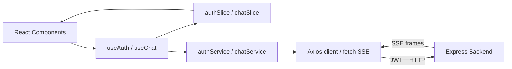
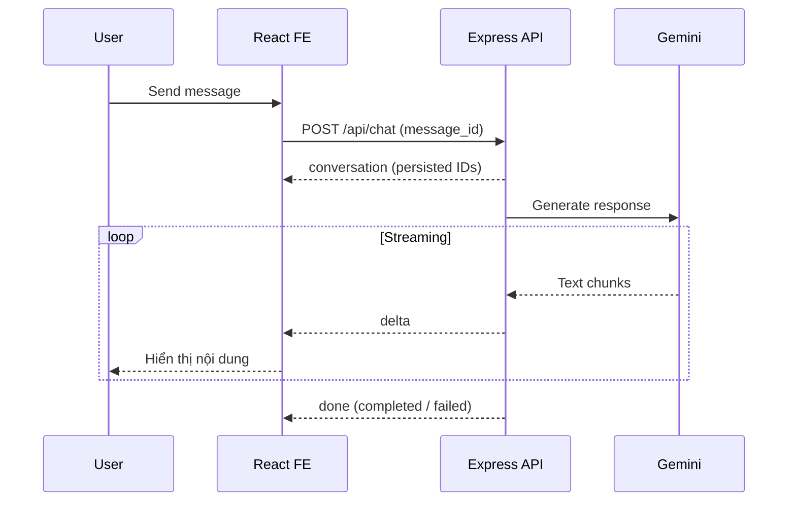

<div align="center">

# 💬 AI Chat Frontend

**Một giao diện chat AI mượt mà — từ tin nhắn đầu tiên đến phản hồi streaming cuối cùng.**

React · TypeScript · Vite · JWT Authentication · Gemini SSE

[](https://react.dev/)
[](https://www.typescriptlang.org/)
[](https://vite.dev/)
[](https://axios-http.com/)
[](#-luồng-chat-streaming)

[🚀 Quick Start](#-quick-start) · [✨ Tính năng](#-tính-năng-nổi-bật) · [🏗️ Kiến trúc](#%EF%B8%8F-kiến-trúc-frontend) · [🔌 API](#-tích-hợp-backend) · [🧪 Kiểm thử](#-kiểm-thử--build)

</div>

---

## 👋 Giới thiệu

**AI Chat Frontend** là ứng dụng chat xây dựng với **React + TypeScript + Vite**, kết nối đến backend Express để xác thực người dùng, quản lý lịch sử hội thoại và hiển thị phản hồi **Gemini theo thời gian thực**.

> [!NOTE]
> Frontend **không gọi trực tiếp Gemini** và không lưu Gemini API key. Mọi yêu cầu AI đi qua backend, với `Authorization: Bearer <access_token>` cho các route được bảo vệ.

<!-- Ảnh demo là tùy chọn: tạo docs/images/chat-demo.png rồi bỏ dấu comment dòng dưới. -->
<!--  -->

## ✨ Tính năng nổi bật

| Trải nghiệm | Chi tiết |
| --- | --- |
| 🔐 **Authentication** | Đăng ký/đăng nhập bằng JWT từ backend; session tồn tại trong **tab hiện tại** |
| ⚡ **AI Streaming** | Đọc SSE qua `fetch`, `TextDecoder` và bộ đệm frame; hiển thị delta theo nhịp 200 ms |
| 💬 **Conversation History** | Sidebar phân trang 50 hội thoại/lần; mở chat tải toàn bộ trang lịch sử, 50 tin nhắn/lần |
| ✍️ **Edit Message** | Sửa tin người dùng, xóa các tin nhắn phía sau và nhận phản hồi AI mới |
| 🔁 **Retry Response** | Thử lại assistant đã lưu với trạng thái `failed` ngay trên cùng bản ghi |
| 🛑 **Stop Generation** | Hủy yêu cầu đang chạy bằng `AbortController`; giữ câu trả lời dở ở trạng thái interrupted |
| 📝 **Manage Conversations** | Đổi tên, xóa hội thoại có xác nhận và dọn sạch cache liên quan |
| 🔔 **Toast Notifications** | Thông báo success / warning / info / error có thể tái sử dụng |

## 🚀 Quick Start

**Điều kiện:** Node.js và npm phù hợp với phiên bản Vite trong dự án; backend AI Chat chạy tại `http://localhost:3001` (mặc định).

### 1. Cài đặt dependencies

```bash
npm install
```

### 2. Cấu hình API URL

Tạo file `.env.local` ở thư mục gốc frontend:

```dotenv
VITE_API_URL=http://localhost:3001
```

Có thể bỏ qua biến này nếu backend vẫn chạy tại địa chỉ mặc định. Sau khi thay đổi `.env.local`, hãy **khởi động lại Vite**.

> [!IMPORTANT]
> Các biến `VITE_*` được nhúng vào bundle frontend. **Không đặt JWT secret, database password hoặc GEMINI_API_KEY vào đây.** Nếu frontend chạy ở origin khác `http://localhost:5173`, cập nhật `CORS_ORIGIN` trên backend.

### 3. Khởi động frontend

```bash
npm run dev
```

Mở URL mà Vite hiển thị trong terminal (thông thường là `http://localhost:5173`). Đăng ký hoặc đăng nhập để bắt đầu chat.

### 4. Kiểm tra chất lượng trước khi bàn giao

```bash
npm test
npm run lint
npm run build
```

Bộ test hiện tại mock API và SSE, **không gọi Gemini** và **không ghi dữ liệu vào database backend**.

## 🏗️ Kiến trúc frontend



### 📂 Các file quan trọng

| File | Trách nhiệm |
| --- | --- |
| `src/api/client.ts` | Axios client chung, base URL, Bearer header và chuẩn hóa lỗi API |
| `src/features/auth/authService.ts` | Gọi login/register, ánh xạ `data.session.access_token` |
| `src/features/auth/authSlice.ts` | Quản lý session, loading và lỗi |
| `src/features/auth/useAuth.ts` | Cung cấp auth state và actions cho component |
| `src/features/auth/authStorage.ts` | Lưu session trong tab hiện tại; xóa khi logout |
| `src/features/chat/chatService.ts` | Axios cho GET; `fetch`, `TextDecoder`, buffer cho POST SSE |
| `src/features/chat/chatSlice.ts` | Pagination, lịch sử cache, optimistic message, IDs và stream status |
| `src/features/chat/useChat.ts` | Điều phối chat, kiểm tra hết hạn session và Stop qua `AbortController` |
| `src/components/toast` | API toast dùng lại trong component |

## 🔐 Authentication & session

Component gọi hook `useAuth()` để đăng nhập hoặc đăng ký:

```ts
const { submit } = useAuth();

await submit("login", { email, password });
// hoặc
await submit("register", { email, password });
```

Cả hai hành động đều đăng nhập ngay bằng JWT backend trả về. `authService` lấy token từ `data.session.access_token`; session lưu backend user ID và thời điểm token hết hạn.

- Mật khẩu đăng ký: **ít nhất 8 ký tự, tối đa 72 byte UTF-8**.
- Session chỉ tồn tại trong tab trình duyệt hiện tại; **không lưu password**.
- Session Supabase cũ bị loại bỏ; logout, token hết hạn hoặc API bảo vệ trả `401` sẽ xóa session **và trạng thái chat**.
- Hiện **không có refresh token hoặc logout API**: khi hết hạn, người dùng cần đăng nhập lại.

## 🔌 Tích hợp backend

| Method | Endpoint | Mục đích |
| --- | --- | --- |
| `POST` | `/api/auth/register` | Đăng ký và nhận session |
| `POST` | `/api/auth/login` | Đăng nhập và nhận session |
| `GET` | `/api/conversations?limit=50&offset=0` | Danh sách hội thoại |
| `GET` | `/api/messages?conversation_id=<UUID>&limit=50&offset=0` | Lịch sử tin nhắn |
| `POST` | `/api/chat` | Gửi tin nhắn, nhận SSE |
| `POST` | `/api/chat/messages/:assistant_id/retry` | Retry assistant bị `failed` |
| `PATCH` | `/api/chat/messages/:user_id` | Sửa user message |
| `PATCH` | `/api/conversations/:id` | Đổi tên hội thoại |
| `DELETE` | `/api/conversations/:id` | Xóa hội thoại |

FE sử dụng **các endpoint canonical** ở trên, không dùng các legacy conversation subroutes. Xem Swagger UI tại [`http://localhost:3001/api-docs`](http://localhost:3001/api-docs) khi backend đang chạy.

### 💬 Gửi một tin nhắn

Tin nhắn đầu tiên tạo `message_id` UUID ở frontend nhằm đảm bảo **idempotency**:

```json
{
  "message_id": "6f4a4dbd-6c63-4412-8cd7-0809c06b5d68",
  "message": "Giải thích React hooks giúp mình nhé"
}
```

Tin nhắn tiếp theo gửi thêm `conversation_id` nhận từ server:

```json
{
  "message_id": "a3920dd4-2af6-4d26-9288-c170df23a90c",
  "message": "Cho mình một ví dụ",
  "conversation_id": "3dd9c265-e11f-4c20-9b8d-2d88a892877b"
}
```

Các UUID chỉ là **ví dụ minh họa**; frontend cần sinh UUID mới cho từng user message.

## ⚡ Luồng chat streaming



### Những SSE event frontend xử lý

| Event | Phản ứng ở frontend |
| --- | --- |
| `conversation` | Nhận conversation và persisted user/assistant IDs |
| `delta` | Cập nhật nội dung assistant (nhịp hiển thị khoảng 200 ms) |
| `reset` | Xóa text tạm, **giữ nguyên assistant ID** |
| `done` | Lưu trạng thái server trả về: `completed` hoặc `failed` |
| `superseded` | Ngừng stream cũ, tải lại lịch sử chuẩn từ backend |
| `error` | Xử lý lỗi, bảo toàn reply dở ở trạng thái interrupted khi phù hợp |

> [!WARNING]
> Frontend **không tự gửi lại tin nhắn** sau lỗi mạng, Stop hoặc ngắt stream. Reply dở được đánh dấu interrupted; thao tác retry chỉ khả dụng với assistant **đã persisted và có trạng thái `failed`**. Hội thoại có assistant chưa được giải quyết sẽ chưa cho gửi tin mới.

## 🧩 Thao tác với tin nhắn và hội thoại

### 🔁 Retry assistant

Gọi `POST /api/chat/messages/:assistant_id/retry` **không cần body**. Retry cập nhật **cùng bản ghi assistant**. Các reply pending/interrupted có thể được làm mới trạng thái bằng cách tải lại history.

### ✍️ Edit user message

Gọi `PATCH /api/chat/messages/:user_id` với body:

```json
{ "message": "Nội dung đã sửa" }
```

Khi lưu, frontend hủy stream cũ, cập nhật user message ban đầu, loại bỏ các `deleted_message_ids` do server trả về và chèn pending assistant mới từ SSE. UI đánh dấu tin đã sửa, đồng thời **cảnh báo rằng các tin nhắn phía sau sẽ bị xóa**.

### 📝 Rename / 🗑️ Delete conversation

- **Rename:** `PATCH /api/conversations/:id` với `{ "title": "Tên mới" }`.
- **Delete:** `DELETE /api/conversations/:id` sau khi xác nhận; nếu stream thuộc hội thoại đó còn chạy thì hủy nó, dọn messages/cache và trở về New Chat.
- Những kết quả stream, danh sách hoặc lịch sử đến muộn **không được khôi phục hội thoại đã xóa**.

### 📚 Pagination và cache

Sidebar tải **50 cuộc hội thoại/trang** với nút **Load more**. Khi mở một hội thoại, frontend nạp tất cả trang lịch sử (**50 tin nhắn/request**) rồi sắp xếp **cũ → mới** trước khi cho phép soạn tin tiếp.

## 🔔 Toast Notifications

`ToastNotifications` đã được mount **một lần** trong `main.tsx`. Trong component/service cần thông báo, import `toast` từ `src/components/toast` (điều chỉnh relative path theo vị trí file):

```ts
import { toast } from "./components/toast";

toast.success("Saved successfully", 3000);
toast.warning("Please check your input", 5000);
toast.info("Check your confirmation email", 7000);
toast.error("Something went wrong", 5000);
```

Tham số thứ hai là **thời gian hiển thị tính bằng milliseconds**. Mặc định: **4000 ms**.

## 🧪 Kiểm thử & build

| Lệnh | Công dụng |
| --- | --- |
| `npm run dev` | Chạy Vite dev server với HMR |
| `npm test` | Kiểm thử tích hợp bằng mock API/SSE |
| `npm run lint` | Kiểm tra lint |
| `npm run build` | Build ứng dụng |

## 🛡️ Lưu ý bảo mật

- Không để `GEMINI_API_KEY`, `JWT_SECRET` hoặc `DATABASE_URL` trong frontend.
- JWT được gửi qua header `Authorization: Bearer <access_token>` khi truy cập API bảo vệ.
- Session hết hạn / `401` phải xóa auth state và chat state để tránh hiển thị dữ liệu phiên cũ.
- Bảo vệ dữ liệu thật được thực thi ở **backend** bằng JWT và kiểm tra quyền sở hữu; frontend chỉ đảm nhiệm trải nghiệm UI.

## 📚 Tài liệu tham khảo

- [React Documentation](https://react.dev/)
- [TypeScript Documentation](https://www.typescriptlang.org/docs/)
- [Vite Documentation](https://vite.dev/guide/)
- [Axios Documentation](https://axios-http.com/docs/intro)
- [React Compiler](https://react.dev/learn/react-compiler) — template hiện bật React Compiler; có thể ảnh hưởng thời gian dev/build.
- [typescript-eslint: Type-aware linting](https://typescript-eslint.io/getting-started/typed-linting/)

> [!TIP]
> Nếu muốn nâng cấu hình ESLint, cân nhắc `recommendedTypeChecked` hoặc `strictTypeChecked` và `stylisticTypeChecked`. Có thể kết hợp thêm `eslint-plugin-react-x` và `eslint-plugin-react-dom` theo nhu cầu. Những plugin React chính thức cho Vite gồm [`@vitejs/plugin-react`](https://github.com/vitejs/vite-plugin-react/tree/main/packages/plugin-react) và [`@vitejs/plugin-react-swc`](https://github.com/vitejs/vite-plugin-react/tree/main/packages/plugin-react-swc). Chỉ thay đổi plugin/compiler khi đã kiểm tra cấu hình thực tế của dự án.

---

<div align="center">

**Built for a smoother AI chat experience. ✨**

<sub>React • TypeScript • Vite • Gemini streaming through Express</sub>

</div>
